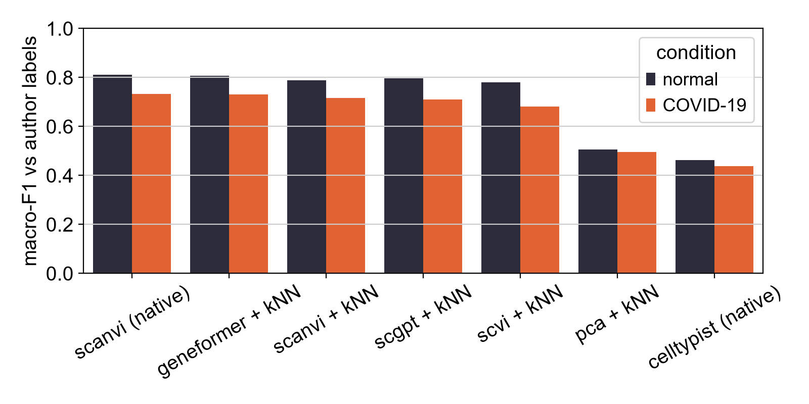

# Do single-cell foundation models annotate diseased lung cells better?

I mapped COVID-19 lung nuclei onto the healthy Human Lung Cell Atlas and asked one question: on diseased cells, do zero-shot foundation models (scGPT, Geneformer) transfer cell-type labels better than scVI/scANVI with scArches, or than CellTypist?

**Short answer: no, but they come close.** Zero-shot Geneformer ties scANVI on COVID cells (macro-F1 0.731 vs 0.734) without seeing the query at all. Every latent method loses about the same amount when moving from control to COVID cells (−0.07 to −0.10), so the foundation models are not more robust to disease. scANVI is clearly better at integration, and scGPT invents ionocytes that aren't there.

## Data

| | Source | Cells | Notes |
|---|---|---|---|
| Reference | HLCA core (Sikkema et al. 2023), CELLxGENE | 96,364 (stratified subsample of 584,944, ≤3,000 per cell type) | healthy, mostly single-cell |
| Query | Melms et al. 2021 (*Nature*), CELLxGENE / GSE171524 | 116,313 | 7 control + 20 COVID-19 autopsy lungs, single-nucleus |

Both are scored on 15 shared coarse lineages (`label_map.csv`). Query truth comes from the authors' `cell_type_intermediate`. The CELLxGENE ontology column can't be used: it files the authors' AT1 cells as "pulmonary alveolar type 2 cell". Cells the reference can't represent (neuronal, "other epithelial", cycling NK/T) are left out of the scores.

## Methods

All methods use the same reference cells. Embeddings are scored with one shared kNN classifier (k=15) fit on the reference.

| Method | Setup |
|---|---|
| PCA | 50 PCs fit on 2,000 reference HVGs |
| CellTypist | SGD logistic regression trained on the reference (5,000 HVGs) |
| scVI / scANVI | trained on the reference (batch = HLCA study), scArches surgery on the query with labels hidden |
| Geneformer | V2-104M (`gf-12L-104M-i4096`), zero-shot |
| scGPT | whole-human checkpoint, zero-shot |

Integration is scored with `scib-metrics` on a 30k-cell joint subsample. Pseudobulk DE uses `decoupler` and `pydeseq2` (donor × lineage, `~ disease`).

## Results

**Label transfer (macro-F1 vs author labels)**

| Method | Control | COVID-19 | Drop |
|---|---|---|---|
| scANVI (native classifier) | 0.812 | **0.734** | 0.078 |
| Geneformer + kNN | 0.807 | 0.731 | 0.077 |
| scANVI + kNN | 0.788 | 0.716 | 0.072 |
| scGPT + kNN | 0.797 | 0.711 | 0.086 |
| scVI + kNN | 0.780 | 0.681 | 0.099 |
| PCA + kNN | 0.506 | 0.495 | 0.010 |
| CellTypist (native) | 0.463 | 0.438 | 0.025 |

All five embeddings separate held-out reference cells almost perfectly (macro-F1 0.96–0.98), so the query gap comes from transfer, not from the embeddings themselves.



- **The models fail in different places.** On COVID cells Geneformer is best for B cells (0.88 vs 0.60 for scANVI) and dendritic cells (0.68 vs 0.29), but much worse on macrophages (0.56 vs 0.90) and NK cells (0.20 vs 0.57). Monocytes and smooth muscle are hard for everyone. See `figures/per_lineage_f1_covid.png`.
- **Methods in raw expression space break on nuclei.** PCA and CellTypist score about 0.45–0.5 on control and COVID cells alike. That points to the single-cell → single-nucleus shift, not to disease: CellTypist gives roughly half the query cells near-zero probability for every class and sends them to "airway epithelial". The latent methods absorb this shift through query surgery (scVI/scANVI) or pretraining (foundation models).
- **Integration (scib-metrics total):** scANVI 0.659 > scVI 0.605 > scGPT 0.528 > Geneformer 0.495 > PCA 0.481. Zero-shot embeddings keep biology about as well as scVI (bio 0.63–0.65 vs 0.64) but don't remove batch effects (batch score 0.27–0.37 vs 0.54–0.55).
- **Hallucinated ionocytes.** The authors annotated no ionocytes, as expected for parenchymal snRNA-seq. scGPT + kNN calls 822 query cells ionocytes. The other methods call 3–19.

**Disease-specific states.** I clustered the query in scANVI space and compared each donor's cluster fractions, COVID vs control:
- A 9,681-cell stromal cluster is strongly enriched in COVID (log2FC +2.3, p = 0.002). It is COL1A1/COL3A1-high with CTHRC1 expression, consistent with the pathological fibroblasts Melms et al. describe.
- Two CD163+/MERTK+ macrophage clusters are also enriched (+1.6 and +1.4).
- These states map onto healthy lineages with high confidence (mean scANVI uncertainty below 0.07). Mapping uncertainty did not flag them as novel. The most uncertain clusters (mean 0.08–0.13) are populations the reference doesn't cover (neuronal, other epithelial). They lean toward COVID, but not significantly (p 0.06–0.09).

**CFTR.** CFTR is not differentially expressed between COVID and control in any lineage (AT2 log2FC −0.61, padj 0.28). Without airway samples there are no ionocytes to look at, so the CFTR link to the MSc thesis stays weak with this cohort.

**Pseudobulk DE.** There are thousands of DE genes per lineage (AT2: 4,538 at padj < 0.05). The top hits are ribosomal and heat-shock genes, which look more like autopsy/ischemia effects than disease biology. Read them with that in mind.

## Caveats

- One cohort, and it is autopsy tissue: COVID donors died of COVID, while controls died of other causes.
- Reference and query differ in technology (single-cell vs single-nucleus) as well as disease, and the two are confounded here.
- Coarse labels only. Fine states like transitional AT2 or CTHRC1+ fibroblasts aren't scored as classes.
- Foundation models are zero-shot only, with no fine-tuning (8 GB GPU). kNN on their embeddings is one reasonable readout, not their best possible score.
- CellTypist is trained on 5,000 HVGs (memory limit), without majority voting.
- Each method ran once with one seed and has no confidence intervals.

## Run

Windows, Python 3.11, two venvs. See `CLAUDE.md` for setup and the smoke test.

```bash
.venv/Scripts/python 01_get_data.py          # downloads ~6.4 GB from CELLxGENE
.venv/Scripts/python 02_baselines.py
.venv/Scripts/python 03_scarches.py
.venv-fm/Scripts/python 04_embed_fm.py scgpt
.venv-fm/Scripts/python 04_embed_fm.py geneformer
.venv/Scripts/jupyter nbconvert --to notebook --execute analysis.ipynb --inplace
```

On an RTX 2060 SUPER the full run takes about 6 h, mostly Geneformer (~3 h).
